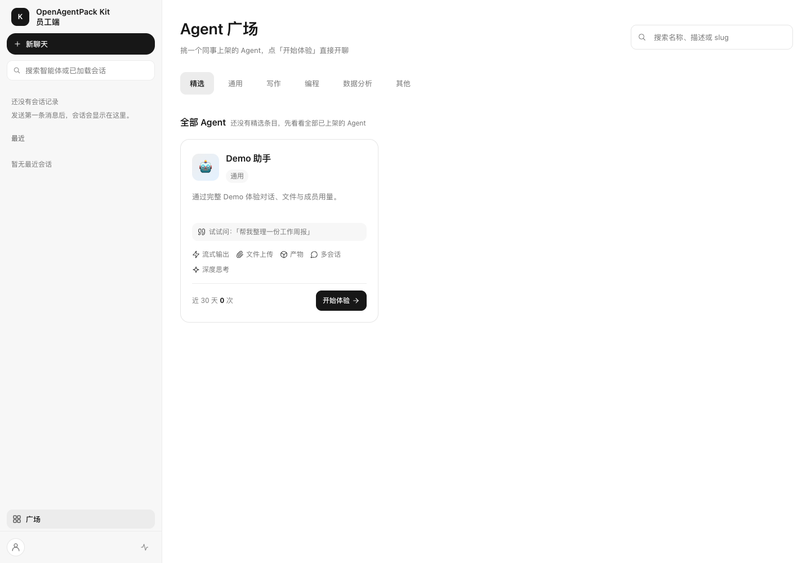
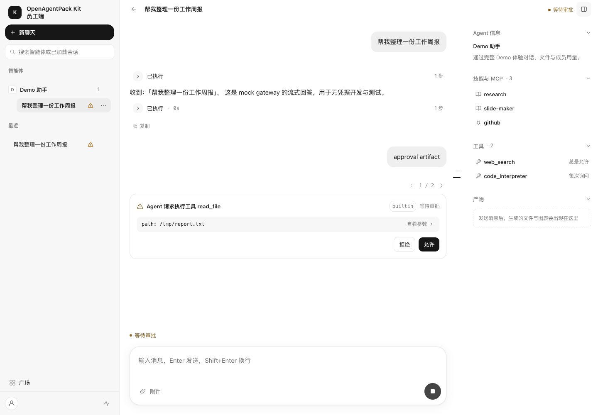
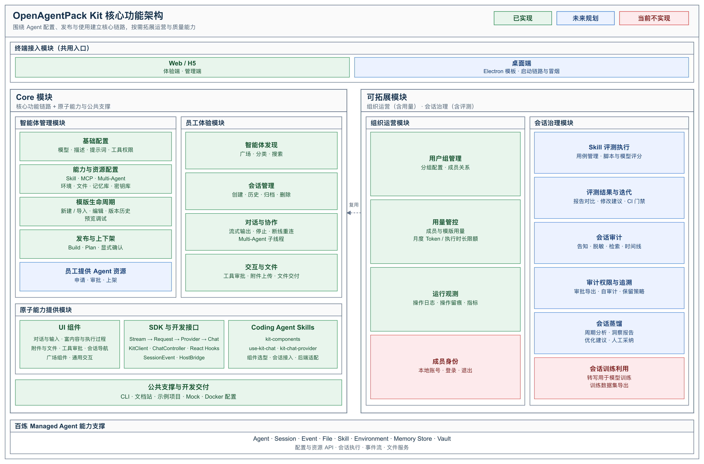
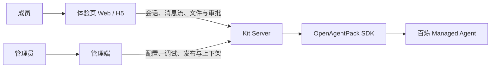

# OpenAgentPack Kit

**OpenAgentPack Kit 是面向百炼 Managed Agent 的应用开发与交付套件。**
它提供可自托管的体验页、管理端和服务端，也提供可按需复用的对话组件、会话运行时、React hooks
与开发 Skill，帮助团队把云端 Agent 接到实际产品中。

团队可以直接搭建自己的 Agent 应用，也可以在已有业务系统中逐步引入所需能力，适用于团队助手门户、
业务工作台中的智能助手，以及需要展示工具执行、人工审批和文件交付的对话场景。

## 背景

一个能在云端运行的 Agent，要真正进入业务，还需要一套让用户发现、使用和持续管理它的产品界面。

例如，团队已经在百炼配置好了一个报告助手，希望成员登录后就能上传资料、查看生成过程、确认工具操作，
再下载报告。开发者需要衔接的环节包括：流式消息与历史会话、附件与文件结果、工具审批、
多 Agent 协作展示，以及账号、用量和部署。它们共同决定了 Agent 能否成为日常可用的业务工具。

## 做了什么

### 提供两条接入路径

| 使用方式 | 交付内容 | 如何开始 |
| --- | --- | --- |
| 搭建完整应用 | 体验页、管理端、Kit Server、仓库脚手架与示例 | 配置服务，导入或创建 Agent，调试并上架，向成员开放使用 |
| 集成到已有系统 | UI 组件、会话运行时、React hooks 与开发 Skill | 复用完整对话界面，或按需组合组件，通过适配层连接现有百炼后端 |

这两条路径复用同一套会话契约与展示能力。团队可以先运行完整应用验证流程，
再根据业务需要定制界面或替换后端接入。

### 从 Agent 配置到成员使用

完整应用围绕「配置 → 预览调试 → 保存与上架 → 成员使用 → 用量管理」组织。

管理员可以导入已有 Agent 的指定版本，配置展示名称、分类、开场白和示例问题，再选择环境、文件、
记忆库与密钥库等运行资源。「导入预设包」还可以发现所选 Agent 关联的可用运行资源，
由管理员查看并选择后带入当前配置。

已有远端配置可以直接复用；新增或修改资源时，通过 YAML 资源批次查看变更计划，显式确认后再发布。
上架前可在管理端预览对话与执行结果；上架后，成员从体验页广场进入使用。
发布负责让资源配置在百炼生效，上架负责开放体验入口，下架会保留云端 Agent 与已有成员会话。

| 能力 | 用户可以完成的工作 |
| --- | --- |
| 发现与会话管理 | 在广场搜索、按分类选择 Agent；从最近会话或 Agent 分组继续工作，重命名、归档或删除会话 |
| 流式对话与执行过程 | 逐步查看回答、思考内容和工具调用；停止当前执行，断线后恢复订阅与历史 |
| 人工审批与多 Agent 协作 | 审阅待执行工具的名称和参数，逐项允许或拒绝；展开子 Agent 卡片查看任务与执行记录 |
| 附件、文件结果与技能 | 在新会话或已有会话中挂载输入附件；按文件类型预览或下载结果；用 `/` 选择当前 Agent 已绑定的技能 |
| 成员与用量管理 | 管理员创建成员账号；会话、上传文件和用量按成员隔离；查看成员、Agent 与会话维度统计，设置日度、月度 Token 和执行时长限额 |

新会话创建时绑定输入附件；已有会话发送新附件时，将附件挂载到当前会话。
技能选择表达本轮使用意图，执行结果以 Agent 实际返回为准。
用量统计用于使用分析和限额管理，计量口径与最终云服务账单分别核算；
达到限额后拦截后续发送，不会强制停止正在执行的一轮。

### 按需复用组件与会话能力

已有产品可以只引入展示组件，也可以连同会话状态管理一起接入。

| 交付部分 | 主要内容 | 适用任务 |
| --- | --- | --- |
| UI 组件 `@openagentpack/kit-chat-ui` | Chat、Message、Sender、Attachments、FileCard、ToolApprovalCard 等 | 组合对话、输入、附件、文件和审批界面；支持将组件及声明依赖复制到业务项目中修改 |
| 会话运行时 `@openagentpack/kit-sdk` 的功能入口 | 流解析、请求、后端适配、消息状态、重连与会话动作 | 接入既有后端，管理流式数据与会话交互；非 React 应用可直接订阅会话状态 |
| React hooks `@openagentpack/kit-sdk/<功能>/hooks` | `useChat`、`useSessions`、`useAgentCatalog` 等 | 将连接、消息、发送、停止与审批绑定到 React 页面 |
| 开发 Skill | `kit-components`、`use-kit-chat`、`kit-chat-provider` | 指导 coding agent 选组件、组合交互并适配后端，配有 API 参考与可编译示例 |

SDK 按功能导入，例如 `@openagentpack/kit-sdk/chat`、`@openagentpack/kit-sdk/chat/hooks`
与 `@openagentpack/kit-sdk/sessions/hooks`，不提供根聚合入口。
Kit Context 由 `@openagentpack/kit-sdk/providers/kit/react` 提供。

开发 Skill 在写代码时提供指导；对话输入框里的技能选择用于向云端 Agent 表达使用意图，
两者分别服务开发过程与业务执行。可直接浏览 [`assets/skills/`](./assets/skills)，
接入说明见[开发 Skill 文档](./apps/storybook/content/docs/skill/index.mdx)。

仓库脚手架、组件交互预览、接口文档和示例共同提供接入参考。项目还提供 Skill 效果评测工具，
支持通过测试案例、断言、报告与版本差异检查评估技能迭代效果。

## 界面预览

| 体验页广场 | 对话、执行过程与工具审批 |
| --- | --- |
|  |  |

## 架构设计



### 应用界面、业务服务与云端执行分层

完整应用的主要调用关系如下：



Kit 部署在团队自己的环境中，提供应用界面、身份与运营管理；Agent 的推理和工具执行由百炼承载。
体验页与管理端可以作为静态资源部署，通过 `/api/config` 注入的 `apiBaseUrl` 连接 Kit Server，
支持前后端分开部署。

| 层次 | 职责 |
| --- | --- |
| 组件与页面 | 提供成员体验与管理入口，展示消息、工具、子 Agent 和文件，通过 hooks 与回调连接业务动作 |
| 会话运行时 | 将事件整理为消息与执行状态，处理历史、实时更新、断线恢复和交互编排 |
| Kit Server | 校验应用身份与会话归属，处理配置发布、文件代理、用量限额和操作记录，通过 SDK 接入百炼 |
| 百炼 Managed Agent | 承载 Agent 运行，提供会话、事件、工具执行与文件结果 |

### 用稳定的契约连接界面与后端

前端数据接入按四层组织，各层都有独立入口：

| 层次 | 处理什么 | 对开发者的作用 |
| --- | --- | --- |
| Stream | 将字节流解码、切分为原始 SSE 帧 | 复用流读取与取消能力 |
| Request | HTTP 请求、身份头、响应与错误 | 统一应用的请求方式 |
| Provider | 将后端接口和事件接入会话合同，提供事件到消息的转换规则 | 连接默认 Kit Server 或自建百炼后端 |
| Chat | 持有事件快照与消息状态，编排重连、发送、停止和审批 | 通过 Controller 或 `useChat` 驱动页面 |

上游 `@openagentpack/sdk` 负责百炼 API 接入与事件规范化；本仓库的 `@openagentpack/kit-sdk`
复用上游的 `SessionEvent` 契约，将事件快照转为可展示的消息、工具状态和文件信息。
历史与实时流进入同一条处理链路，同一事件的后续快照会更新对应展示，UI 使用稳定的消息分片标识。

采用 Kit Server 时可复用仓库的 Provider 接入；已有后端时，可以实现 `ChatProvider`，
也可以使用 `@openagentpack/kit-sdk/providers/bailian` 的 `createBailianChatProvider`
接入自建后端转发的百炼原始 SSE，Provider 凭据仍保留在服务端。
业务方可保留自己的身份、会话目录与文件接口。完整会话接入需要明确的订阅就绪、历史恢复、发送、
中断和审批，详见[架构](./docs/architecture.md)与[协议](./docs/protocol.md)。

### 仓库组成

| 层 | 包 | 职责 |
| --- | --- | --- |
| 契约 | `@openagentpack/kit-sdk/protocol` | SDK 子入口：同构事件、SSE 帧、错误模型与 API schema |
| SDK | `@openagentpack/kit-sdk` 的功能入口 | 按功能提供请求、Provider、聊天、会话、文件、认证和用量；React 通过各功能 `/hooks` 可选接入，Kit Context 在 `/providers/kit/react`，通用屏幕判断在 `/hooks`；管理业务归 Console |
| UI 组件 | `@openagentpack/kit-chat-ui` | copy-in Chat 产品 UI（Radix + Tailwind v4） |
| 服务端 | `@openagentpack/kit-server` | Hono 应用工厂：数据面 `/api/kit/*`、控制面 `/api/admin/*` |

仓库内脚手架与打包命令位于 `scripts/kit/`，通过根 `pnpm kit:create`、`pnpm kit:add`、
`pnpm catalog:list` 调用。

应用：`apps/web`（体验页）、`apps/console`（管理端）、`apps/server`（服务端）。

### 目录结构

```text
OpenAgentPack-Kit/
├── apps/                       # 可运行应用
│   ├── web/                    # Web / H5 体验页
│   ├── console/                # 管理端
│   ├── server/                 # Kit Server
│   └── storybook/              # Fumadocs 文档站
├── packages/                   # 功能包
│   ├── sdk/                    # 会话运行时、协议、后端适配与 React hooks
│   ├── chat-ui/                # 对话与交互组件
│   └── eval/                   # Skill 效果评测工具
├── assets/
│   └── skills/                 # 生成的开发 Skill，供 coding agent 使用
├── templates/
│   └── web-experience/         # 体验页脚手架模板
├── scripts/
│   ├── kit/                    # 项目创建、组件复制与组件目录命令
│   ├── skills/                 # 开发 Skill 源码、生成与打包脚本
│   └── dev.mjs                 # 本地开发启动入口
├── docs/                       # 项目设计与开发文档
│   ├── adr/                    # 架构决策记录
│   ├── images/                 # README 等文档使用的图片
│   └── research/               # 上游调研与技术证据
├── .githooks/                  # Git 提交与推送检查
├── .env.example                # 环境变量示例
├── AGENTS.md                   # 仓库开发规则入口
├── package.json                # 根依赖与常用命令
└── pnpm-workspace.yaml         # 工作区配置
```

上游 SDK 使用 npm 正式发布的 `@openagentpack/sdk@0.10.0`，由精确版本与
`pnpm-lock.yaml` integrity 锁定。

## 文档

- [使用文档](./apps/storybook/README.md)：快速开始、本地 Demo、核心概念、SDK、组件、API 与开发 Skill。
- [工程文档](./docs/README.md)：架构、目录、接口、协议、测试与 ADR。
- 核心参考：[架构](./docs/architecture.md)、[接口](./docs/interfaces.md)、[协议](./docs/protocol.md)、
  [测试与验收](./docs/validation.md)。
- [贡献指南](./apps/storybook/content/docs/contributing.mdx) 与 [仓库开发规则](./AGENTS.md)。

## 优势

### 覆盖完整交付链路

从管理员准备 Agent，到成员使用，再到用量与限额管理，项目提供相互衔接的应用流程。
团队可以在可运行的基础上调整业务逻辑，减少反复建设登录、会话、文件、审批和运营界面的工作。

### 原生对接 MA 协议，与底座持续演进

OpenAgentPack Kit 原生对接百炼 Managed Agent（MA）协议，围绕会话、事件流、工具调用、人工审批、
多 Agent 协作与文件交付提供适配。开发者可以复用协议解析、事件归并和状态同步能力，
专注于业务场景与产品体验。组件、会话运行时和开发指南随 MA 能力演进持续更新。

### 可以从所需的一层开始

完整应用、UI 组件、会话运行时与 React hooks 可以按需选择。
已有后端的团队能够保留自己的接口与身份体系；已有前端的团队可以继续使用自己的界面，
复用会话状态与连接能力，逐步完成接入。

### 适配 Agent 任务的交互过程

工具调用、人工审批、子 Agent 执行和文件结果都有对应的展示与操作入口。
用户可以跟踪工作进展、作出必要决定，并在任务结束后获取结果；
历史与实时流的统一处理也支持继续未完成的工作。

### 源码、接口与开发指南一起交付

项目采用 Apache-2.0 许可证。组件支持源码复制和业务定制，会话能力通过公开 TypeScript 接口组合；
文档、示例与 Skill 为人工开发和 AI 辅助开发提供共同参考。
团队可以从完整示例起步，持续演进自己的 Agent 应用。

## 快速开始

环境要求：Node.js ≥ 24，pnpm 9.15.9。

```bash
pnpm install
pnpm setup                 # 让 git 使用 .githooks
cp .env.example .env       # 填 BAILIAN_API_KEY + BAILIAN_WORKSPACE_ID
pnpm dev                   # server :8787 + web :5173 + console :5174 + storybook :3000
pnpm dev server web console # 只起指定目标
```

没有凭据时设 `KIT_GATEWAY=mock`，可用内置 mock gateway 端到端跑通全链路（流式事件、
工具调用、artifact）。仓库根的 `.env` 是 dev 场景的凭据权威来源：与 shell 同名变量冲突时
以 `.env` 为准（`scripts/dev.mjs` 只打印被覆盖的变量名，不打印值）。

### 配置

复制 `.env.example` 为 `.env` 后按需填写：

| 变量 | 必填 | 说明 |
| --- | --- | --- |
| `BAILIAN_API_KEY` | 连接真实 Provider 时必填 | 百炼 API Key，只存在于服务端 |
| `BAILIAN_WORKSPACE_ID` | 与 `BAILIAN_BASE_URL` 二选一 | 用于推导 Provider 地址 |
| `BAILIAN_BASE_URL` | 与 `BAILIAN_WORKSPACE_ID` 二选一 | 显式指定 Provider 地址 |
| `ADMIN_TOKEN` | 是 | 管理端登录令牌 |
| `KIT_GATEWAY` | 否 | `auto`（默认）、`mock` 或 `sdk` |
| `KIT_AUTH_MODE` | 否 | `member`（默认）或 `anonymous` |
| `KIT_DATA_DIR` | 否 | 本地数据目录，默认 `.data` |
| `KIT_CORS_ORIGINS` | 否 | 允许跨域的体验页来源 |
| `KIT_PUBLIC_BASE_URL` | 否 | 跨域部署时的公开服务地址 |
| `KIT_JWT_SECRET` | 否 | 可选的可信 JWT 身份扩展 |
| `KIT_ADMIN_TOKENS` | 否 | 追加 `admin` / `auditor` 令牌，格式 `<token>:<role>` |

### 部署

- 前端：`pnpm build` 后静态托管 `apps/web/dist`、`apps/console/dist`、`apps/storybook/out`。
- 服务端：`node apps/server/dist/bin.js`；`KIT_DATA_DIR` 必须位于持久化磁盘。
- 反向代理：`/api` 与静态资源分别回退，不要把 API 错误改写成 HTML。
- 跨域直连：配置 `KIT_PUBLIC_BASE_URL` 与 `KIT_CORS_ORIGINS`；同源部署使用 `/api/config` 的空 `apiBaseUrl`。

完整说明见[部署文档](./apps/storybook/content/docs/guides.mdx)。

## 本地体验：创建 → 发布 → 预览调试 → 上架 → 对话

从管理端创建或导入配置，无需本地目录型示例工程：

```bash
pnpm dev server web console
```

1. 打开[管理端](http://localhost:5174)，使用 `.env` 的 `ADMIN_TOKEN` 登录，进入「创建智能体」，
   选择「导入现有配置」或「从零开始创建」，填写展示信息、智能体配置及所需运行时资源。
2. 点击「下一步：预览调试」。若有待发布资源，先审阅本批次计划并显式确认发布；仅复用已有远端
   配置时直接进入预览。调试后点击「保存智能体」，保存为模版。
3. 在「智能体管理」列表点击「上架」，审阅计划并确认；在「成员管理」中创建成员账号。
   然后打开[体验页](http://localhost:5173)，使用成员账号登录，在广场选择已上架的智能体开始对话。

`KIT_GATEWAY=mock` 使用本地模拟数据；连接真实 Provider 时，确认发布会创建远端资源。
测试与验收命令见 [`docs/validation.md`](./docs/validation.md)。

## 安全

- Provider 凭据（`BAILIAN_API_KEY`、vault credential 等）只存在于服务端，不下发浏览器、不写入仓库或日志。
- `apply` / `destroy` / `publish` / 上下架等破坏性操作必须经过 plan 与显式确认，不能代替用户补确认。
- 发现安全问题请不要公开提交 issue；请通过 GitHub Security Advisory 或维护者私下联系。

## 参与开发

先读 [`AGENTS.md`](./AGENTS.md)：它定义了冲突时的权威顺序、必须停下来记录阻塞的红线、
以及验收门禁。架构 / 目录 / 接口 / 协议 / 测试规则在 [`docs/`](./docs)。
```bash
pnpm gate        # typecheck + lint + test + build + 架构检查 + 文档检查
pnpm verify:push # pre-push hook 跑的就是这套
```

提交信息使用简体中文 Conventional Commits，例如 `fix(server): 修复会话恢复`。
Issue 与反馈：https://github.com/modelstudioai/OpenAgentPack-Kit/issues

## License

Apache-2.0，见 [LICENSE](./LICENSE) 与 [NOTICE](./NOTICE)。
